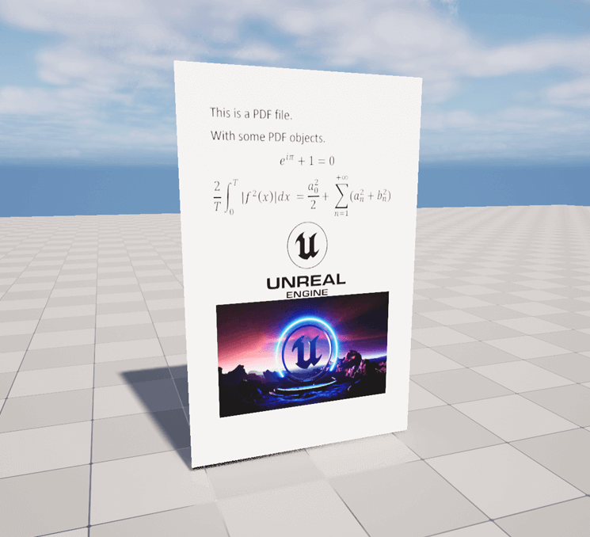

  

    

      {{tag}}
    

    <h1>{{hero_title}}</h1>
    
{{hero_subtitle}}

    

      <a class="pv-button" href="https://www.fab.com/listings/4b675d25-f2f9-4537-b2f3-5406b846f6ac">
        {{primary_cta_text}}
        
      </a>
      <a class="pv-button-secondary" href="#/umg">Quickstart documentation</a>
    

  

  

    

    
  

  

    {{section_getting_started}}
    <h2>{{docs_title}}</h2>
  

  

    <a class="pv-card-step" href="#/umg">
      

        
UI

        UMG Widget
      

      

        <h3>Render PDF in UMG</h3>
        
Display document pages dynamically inside Blueprint UI layouts.

        

          

            1
            

              <strong>Create Widget Blueprint</strong>
              Add a <code>UImage</code> component and mark it as <code>Is Variable</code>.
            

          

          

            2
            

              <strong>Render PDF Page</strong>
              Load document, render first page to a texture target.
            

          

          

            3
            

              <strong>Assign & Display</strong>
              Pass texture to image brush and configure resolution.
            

          

        

      

      

        Read Full UMG Guide
        <svg fill="none" height="18" stroke="currentColor" stroke-linecap="round" stroke-linejoin="round" stroke-width="2" viewBox="0 0 24 24" width="18"><line x1="5" x2="19" y1="12" y2="12"></line><polyline points="12 5 19 12 12 19"></polyline></svg>
      

    </a>    <a class="pv-card-step" href="#/world">
      

        
3D

        World Actor
      

      

        <h3>Render PDF in World</h3>
        
Project documents onto 3D surfaces and meshes in the viewport.

        

          

            1
            

              <strong>Create Actor Blueprint</strong>
              Add a <code>Plane</code> or custom mesh component.
            

          

          

            2
            

              <strong>Create Material</strong>
              Set Shading Model to <code>Unlit</code> for clear readability.
            

          

          

            3
            

              <strong>Apply Texture Param</strong>
              Bind dynamic material instance to PDF stream.
            

          

        

      

      

        Read Full World Guide
        <svg fill="none" height="18" stroke="currentColor" stroke-linecap="round" stroke-linejoin="round" stroke-width="2" viewBox="0 0 24 24" width="18"><line x1="5" x2="19" y1="12" y2="12"></line><polyline points="12 5 19 12 12 19"></polyline></svg>
      

    </a>
  

  

    {{section_api}}
    <h2>{{api_title}}</h2>
  

  

    <a class="pv-card" href="#/document">
      

        
DOC

        

          <svg fill="none" height="20" stroke="currentColor" stroke-linecap="round" stroke-linejoin="round" stroke-width="2" viewBox="0 0 24 24" width="20"><line x1="5" x2="19" y1="12" y2="12"></line><polyline points="12 5 19 12 12 19"></polyline></svg>
        

      

      

        <h3>{{api_document_title}}</h3>
        
{{api_document_description}}

      

    </a>    <a class="pv-card" href="#/page">
      

        
PG

        

          <svg fill="none" height="20" stroke="currentColor" stroke-linecap="round" stroke-linejoin="round" stroke-width="2" viewBox="0 0 24 24" width="20"><line x1="5" x2="19" y1="12" y2="12"></line><polyline points="12 5 19 12 12 19"></polyline></svg>
        

      

      

        <h3>{{api_page_title}}</h3>
        
{{api_page_description}}

      

    </a>
  

<a class="pv-support" href="#/troubleshoting">
  

    {{support_label}}
    <h3>{{support_title}}</h3>
    
{{support_description}}

  

  

    {{support_cta}}
    <svg fill="none" height="18" stroke="currentColor" stroke-linecap="round" stroke-linejoin="round" stroke-width="2" viewBox="0 0 24 24" width="18"><line x1="5" x2="19" y1="12" y2="12"></line><polyline points="12 5 19 12 12 19"></polyline></svg>
  

</a>